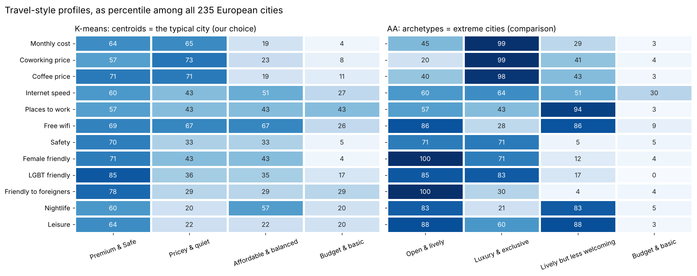

# Four ways to travel in Europe

Two connected analyses for a travel website, built on a dataset of digital-nomad cities and trips:

1. **[Travel styles](01_travel_styles_clustering.ipynb):** groups 235 European cities into four
   travel styles with **K-means**, compared with **Archetypal Analysis** (AA).
2. **[Next-trip recommender](02_next_trip_recommender.ipynb):** suggests a traveller's next
   destination with **item-based collaborative filtering** on 37,000 real trips.



## Part I · What kinds of cities are there?

Each city is described by 12 features a traveller cares about: cost, internet and places to work,
safety and openness, nightlife and leisure. Cost and internet speed are log-transformed, and
missing values recorded as `0` are imputed from the same country or sub-region.

| Travel style | Typical cities | In short |
|---|---|---|
| **Premium & Safe** | Copenhagen, Berlin, London, Lisbon | safe, open, lots to do; about $3,000 a month |
| **Pricey & quiet** | Rimini, Luxembourg, Erlangen | almost as expensive, with less to do |
| **Affordable & balanced** | Budapest, Bucharest, Zagreb | about 40 % cheaper, good wifi and nightlife |
| **Budget & basic** | Kiev, Kharkiv, Samara | the cheapest, but the least safe and welcoming |

**Why K-means and not AA?** A "Browse by travel style" page needs every city in one clear
category. AA describes extreme profiles that few real cities match: 96 of 235 cities are less
than 50 % any single archetype. The two methods agree only partly (ARI = 0.35); the main
difference is that the popular, affordable middle of Europe gets its own group only in K-means.

The notebook also builds a *"You might also like"* list from the nearest cities in the same
style (e.g. Aalborg → Aarhus, Bergen, Reykjavik).

## Part II · Where should a traveller go next?

After removing trips that only record a country ("a trip to Spain"), a traveller × place matrix
links places that the **same people** visited. Cosine similarity between places drives the
recommendations, and only places with 50+ travellers are recommended, so every suggestion is
backed by evidence.

| Customer has visited | Top recommendation | Why |
|---|---|---|
| Athens, Berlin, Lisbon | **Barcelona** | 181 Berlin travellers and 142 Lisbon travellers also went there |
| Bangkok, Chiang Mai | **Kuala Lumpur** | then Singapore, Ho Chi Minh City, Phuket, Ubud |

**Limitations:** popularity bias (big hubs like Barcelona are recommended often) and cold start
(a customer with no trips gets no recommendation).

## Run it

```bash
pip install -r requirements.txt
jupyter notebook
```

The data is read directly from the course website, so nothing needs downloading.

## Background

Based on an assignment in the MSc in Business Data Science, Aalborg University (2026). This
repository is my own version.
